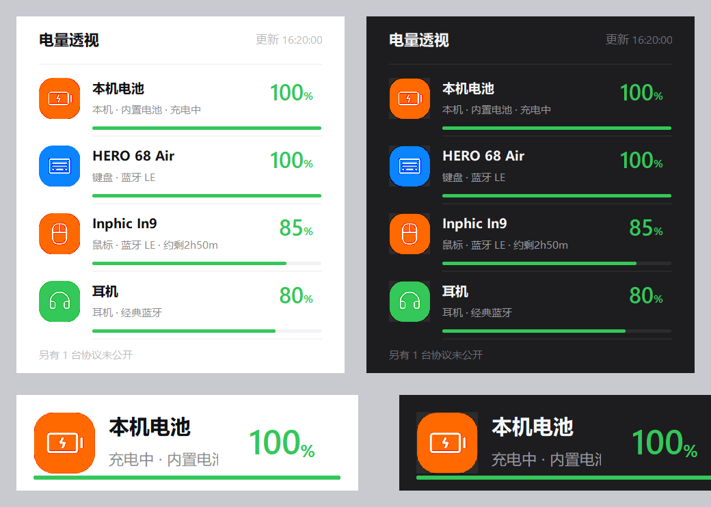

# 电量透视 BatteryLens

Windows 桌面小工具：读取蓝牙 / USB 外设的**真实电量**，以「桌面胶囊卡片 +
任务栏贴片」展示。原生 Win32 实现，单进程、单文件绿色 exe、零联网。

原则：所有百分比都来自设备真实上报，绝不生成模拟数据；读不到就明确标注原因。

> ✨ 本项目由 **my** 与 **ZCode AI 助手（GLM）** 共同完成 —— 人机结对，从需求到发布。



## 下载

- **免安装**：从 [Releases](../../releases/latest) 下载 `BatteryLens-1.0-win64.zip`，
  解压双击 `BatteryLens.exe` 即用（单文件、无需 Python、不写注册表）。
- **源码运行**：`pip install -r requirements.txt` 后双击 `start.bat`
  （或 `python widget.py`）。需要 Python 3.10+ / Windows 10-11 x64。

首次运行后：托盘出现程序主图标（显示最低电量），桌面右下角出现胶囊卡片，
鼠标移上去展开全量列表。设置会在首次更改时自动生成于程序同目录
（字段见下方说明，亦可参考 `settings.example.json`）。

> `start.bat` 会优先寻找作者机器上的内置 Python 作为加速项，普通环境
> 自动回退到系统 Python，无需任何配置。

## 两种显示形态（右键托盘主图标切换）

| 形态 | 说明 |
|---|---|
| 桌面卡片 | 右下角胶囊卡：图标 + 名称/续航 + 电量字 + 进度条，多设备自动轮换，悬停展开列表 |
| 任务栏贴片 | 彩色电量圆点直接嵌进任务栏（通知区左侧），逐台设备一眼可读 |

## 功能

- **真实读数**：BLE GATT 标准电池服务（0x180F/0x2A19）+ Windows PnP
  缓存电量（DEVPKEY_Device_BatteryLevel）。本机电池不显示——任务栏已有。
- **诚实标注**：协议未公开 / 系统不暴露的设备显示「—」并注明原因。
- **续航倒计时**：按最近 40 分钟读数估算放电速度，展开列表显示「约剩 2h13m」；
  斜率不足（刚插上 / 闲置 / 读数粒度太粗）时不显示，绝不含糊编数。
- **充电管家**：外设电量回升 / 充满时各提醒一次。外设无充电标志，
  按读数上升沿推断，文案如实说「电量正在回升」。
- **低电量气泡提醒**：右键菜单选阈值（关闭 / 10 / 15 / 20 / 30%）。
- **跟随系统深浅色**：主题选「跟随系统」即自动切换。
- **健壮性**：「显示桌面」/ 最小化全部不影响卡片；意外隐藏可在 5 秒内自愈，
  或点击托盘图标一键召唤；Explorer 重启后任务栏贴片自动重挂。
- **低功耗**：低于正常优先级；全屏 / 演示模式自动隐藏卡片并降频；
  设备台账缓存 30 分钟；单实例锁防重复启动。

## 托盘图标

- **左键**：召唤悬浮卡（任何形态 / 忙碌状态下点击必现，并立即刷新）。
- **右键**：菜单——立即刷新 / 主设备（卡片固定显示哪台）/ 低电量提醒阈值 /
  显示为任务栏贴片 / 开机自启动 / 窗口置顶 / 切换主题 / 退出。

## 设置（settings.json，与 exe / 脚本同目录）

```json
{
  "mode": "widget",                     // widget 卡片 / taskbar 贴片
  "topmost": true,                      // 卡片全局置顶
  "theme": "auto",                      // light / dark / auto 跟随系统
  "primary": "auto",                    // 卡片固定显示某设备 id，auto=轮换
  "aliases": {"ble:XX:XX": "我的鼠标"}, // 设备别名（显示名）
  "low_at": 20                          // 低电量提醒阈值，0=关闭
}
```

## 项目结构

```
BatteryLens/
├── widget.py 等 5 个模块    ← 运行时源码（互相 import 的一个整体，保持同层）
├── start.bat                ← 源码运行入口（双击）
├── requirements.txt         ← 依赖清单
├── settings.example.json    ← 设置模板（运行时自动生成真实 settings.json）
├── assets/                  ← 图标 SVG 素材与预渲染 PNG
├── tests/                   ← 单元/回归测试（run_all.py 统一入口）
├── tools/                   ← build_exe.py 打包 / _gen_icons.py 素材生成 / ui_preview.png
└── dist/                    ← 产物：BatteryLens.exe 与分发包 zip（不入库）
```

## 构建与自检

```bat
python tools\build_exe.py      :: 打包 dist\BatteryLens.exe
python widget.py --check       :: 自检（功耗/采集/渲染/置顶/崩溃兜底）
python tests\run_all.py        :: 单元/回归测试（合成数据打桩，无窗口）
python tools\_gen_icons.py     :: 重新生成 assets/gen 图标素材（换图标时才需要）
```

## 资产与致谢

- 设备图标基于 [Phosphor Icons](https://phosphoricons.com)（MIT，声明见
  `assets/LICENSE`），经 `tools/_gen_icons.py` 二次渲染。
- 视觉语言参考小米 HyperOS 小组件。
- 本项目由 **my** 与 **ZCode AI 助手（GLM）** 共同完成——从需求、设计、
  编码、测试到打包分发，全部环节由人与 AI 结对完成。

## 已知边界

- 2.4G 接收器模式下的外设电量走厂商私有协议，Windows 不向应用暴露，标注为
  「协议未公开」；BLE 模式下同一设备通常有标准读数。
- 全屏游戏 / 演示模式中卡片自动隐藏、扫描降频，是设计行为；
  若需强行显示，点击托盘图标即可。
